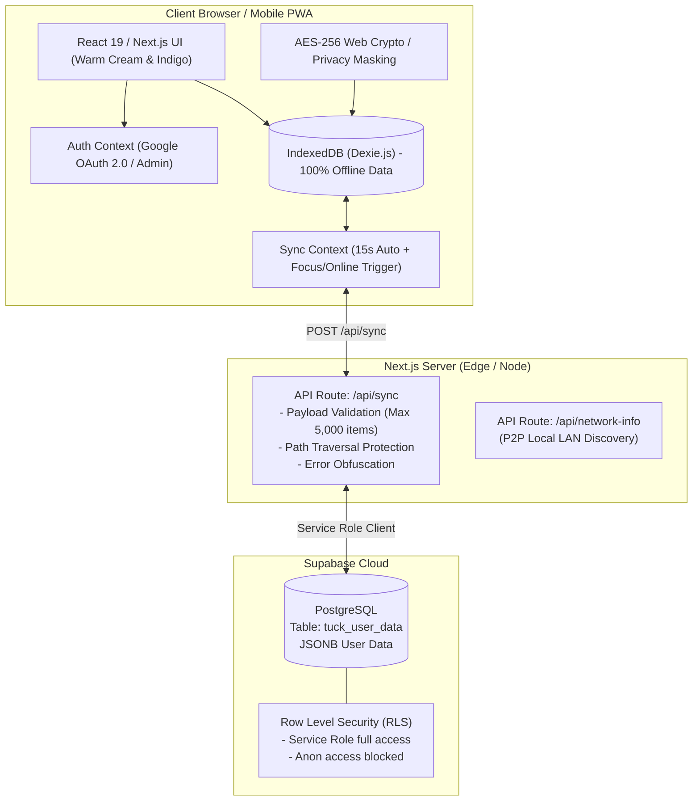

# Tuck — Your Personal Space

<div align="center">


<br/><br/>

[](https://tuck-vault.vercel.app)
[](https://github.com/raviattrash-pro/tuck-vault)
[](https://nextjs.org/)
[](https://www.typescriptlang.org/)
[](https://supabase.com/)
[](https://github.com/raviattrash-pro/tuck-vault)
[](https://github.com/raviattrash-pro/tuck-vault)
[](https://opensource.org/licenses/MIT)

<br/>

[](https://github.com/raviattrash-pro/tuck-vault/stargazers)
[](https://github.com/raviattrash-pro/tuck-vault/network/members)
[](https://github.com/raviattrash-pro/tuck-vault/watchers)

<p align="center">
  <b>A private, calm, and unified personal vault for identity cards, daily routine checklists, monthly budgets, and curated links.</b><br>
  Built with offline-first Dexie IndexedDB, real-time Supabase cloud synchronization, Google OAuth 2.0, and zero unwanted mock data.
</p>

> ⭐ **Enjoying Tuck?** Give the repository a star to support active development and help more developers discover privacy-first tools!

[Explore Features](#-features) • [Problem & Solution](#-the-problem--the-solution) • [Security Standard](#-industry-security-standards) • [Architecture](#-system-architecture) • [Getting Started](#-getting-started) • [Contributing](#-contributing)

</div>

---

## 💡 The Problem & The Solution

### ❌ The Everyday Problem
Most people have their critical personal assets scattered in total disorder:
1. **Scattered Identity Cards**: Aadhaar, PAN, Driving Licence, and Passport scans end up buried inside WhatsApp self-chats, messy phone photo albums, or Google Drive folders. When you urgently need your card number or a photo upload, you waste 10 minutes digging through thousands of photos.
2. **Exposed Credentials**: Screenshots of ID cards lying unmasked on your camera roll expose sensitive identity numbers to anyone who glances at your phone or browses your photos.
3. **Bloated Task & Budget Tools**: Traditional task apps are cluttered with enterprise project features. Budget apps often force you to link bank accounts and hand over login passwords just to track simple grocery expenses and monthly savings.
4. **Lost Bookmarks**: Great articles, financial calculators, and recipes saved across Safari, Chrome, and Instagram get forgotten and lost in endless browser history tabs.
5. **Connectivity Fragility**: Most web apps freeze, show loading spinners, or lose unsaved edits the second you walk into an elevator, basement, or flight.

### ✅ How Tuck Solves It
**Tuck** replaces friction and fragmentation with a single, calm, private space designed for everyday life:
- 🛡️ **Zero-Friction Document Vault**: Stores your essential identity documents with **numbers masked by default** (`•••• •••• 4821`). Easily reveal with a tap, and download front/back scans with 1 click.
- 📋 **Routine Checklists with Sub-Tasks**: Set your morning or weekend routines. Add hierarchical sub-tasks, toggle completion interactively, and view live progress bars.
- 👛 **Lightweight Budgets & Lists**: Track planned vs. actual monthly expenses (e.g. *₹32,450 of ₹45,000 planned*) and grocery checklists without linking bank accounts.
- 🔗 **Curated Web Links**: Save articles and reference links categorized neatly with automatic favicon and domain detection.
- ⚡ **100% Offline-First (PWA)**: Reads and writes instantly to client-side IndexedDB. Everything continues working without internet, seamlessly synchronizing to Supabase the moment you reconnect.
- 🔒 **Zero Unwanted Clutter**: Starts with a 100% clean slate tied directly to your authenticated Google account. No dummy or demo data to delete.

---

## 🌟 Key Benefits

| Benefit | How It Helps You |
| :--- | :--- |
| **Instant Access Anywhere** | Access your Aadhaar or DL number in 3 seconds from your phone, tablet, or work laptop. |
| **Complete Peace of Mind** | End-to-end encrypted local storage (AES-256) + Row Level Security ensures only **you** can access your vault. |
| **Fast Dual-Sided Downloads** | Instantly download both front and back card images formatted for official portal uploads. |
| **Bulletproof Offline Support** | Fully installable Progressive Web App (PWA) with service workers; never stops working offline. |
| **Zero Server Cost** | Runs on free-tier Supabase PostgreSQL and Vercel edge infrastructure with zero operational maintenance. |
| **Privacy By Default** | Sensitive ID numbers remain masked on screen until you intentionally reveal them. |

---

## 📱 Features

### 1. 🛡️ Identity & Document Vault
- Encrypted storage for **Aadhaar, PAN, Voter ID, Driving Licence, Passport, Office ID, and Custom documents**.
- **Privacy Masking**: Document numbers are masked by default (`•••• •••• 4821`) to protect against shoulder-surfing.
- **Biometric / PIN Reveal**: 1-click reveal toggle with visual feedback.
- **Dual-Sided Card Previews**: Upload front and back card images with instant preview and dual-sided download buttons.

### 2. 📝 Notes & Priority Checklists
- Freeform note-taking and structured to-do checklists.
- **Sub-task Checklists**: Break any note into checkable sub-items with immediate completion percentages and strike-throughs.
- **Priority Badging**: High 🔴, Medium 🟡, and Low 🟢 priority tags.
- **Filter Chips**: Quickly switch between `All`, `Notes`, `To-dos`, and `Pinned`.

### 3. 👛 Smart Budgets & Lists
- **Monthly Budget Trackers**: Set monthly planned budgets and track itemized expenses with visual percentage progress bars.
- **Interactive Checklists**: Grocery lists, shopping lists, and investment goals with quantity and amount tracking.
- **Live Counter**: Displays `X checked off · Y items left` automatically.

### 4. 🔗 Curated Web Links ("Worth Coming Back To")
- Save articles, recipes, tools, and reading bookmarks.
- Automatic domain extraction, favicons, and category tagging (`Reading`, `Money`, `Recipes`, `Work`, `Reference`).
- 1-click external tab opening and clean deletion.

### 5. 🔄 Realtime Cloud Sync (Supabase PostgreSQL)
- Two-way timestamped collection merge engine (`/api/sync`).
- Automatic background synchronization on page focus, internet reconnection, or every 15 seconds.
- Multi-device continuity: Log in on a phone or laptop and see your vault update instantly.

### 6. 🤝 Peer-to-Peer Sharing (ToffeeShare & QR Code)
- **QR Code Sharing**: Generates compressed base64 QR payloads for fast scanning.
- **Nearby Share**: Direct WebRTC P2P channel transfer across devices on the same local Wi-Fi.
- **Import Link**: Share items via `/share?data=...` with instant client-side decoding.

---

## 📐 System Architecture



---

## 🛡️ Industry Security Standards

Tuck follows modern defensive cybersecurity and data protection standards:

### 1. Secret Protection & Zero Git Exposure
- **No Secrets in Git**: Verified that `.env`, `.env.local`, API keys, and database passwords are **never** committed.
- **Gitignore Enforcement**: `.gitignore` strictly ignores `.env*` while tracking only non-sensitive `.env.example`.
- **Public vs Private Keys**: Only `NEXT_PUBLIC_` variables (like Google OAuth Client ID) are exposed to browsers. Secret service keys reside exclusively in the backend runtime environment.

### 2. HTTP Security Headers (OWASP Recommended)
Configured in `next.config.ts`:
- **`Strict-Transport-Security`**: `max-age=63072000; includeSubDomains; preload` (enforces HTTPS).
- **`X-Frame-Options`**: `DENY` (prevents clickjacking attacks).
- **`X-Content-Type-Options`**: `nosniff` (mitigates MIME-type confusion attacks).
- **`Referrer-Policy`**: `strict-origin-when-cross-origin` (prevents leaking sensitive query params).
- **`Permissions-Policy`**: `camera=(), microphone=(), geolocation=()` (restricts browser hardware access).

### 3. Supabase Row Level Security (RLS)
- The `tuck_user_data` table has RLS enabled by default.
- Anonymous public browser queries attempting to scrape records are blocked (`TO anon USING (false)`).
- The Next.js `/api/sync` backend communicates securely using the server-side service role.

### 4. Client-Side Encryption & Masking
- Sensitive document numbers are masked by default (`maskDocumentNumber`).
- The application provides Web Crypto API AES-256-GCM encryption with PBKDF2 key derivation (100,000 iterations) and 12-byte cryptographic IVs.

### 5. API Hardening & Denial of Service Protection
- `/api/sync` enforces strict input format validation on user keys (email length limited to 254 characters).
- Maximum collection limits (5,000 records per collection) prevent memory exhaustion attacks.
- Hex-encoded path sanitization completely eliminates path traversal (`../`) vulnerabilities.

---

## 🚀 Getting Started

### Prerequisites
- Node.js 18.x or higher
- npm, yarn, or pnpm
- (Optional) A free [Supabase](https://supabase.com) account for cloud sync

### 1. Clone the Repository
```bash
git clone https://github.com/raviattrash-pro/tuck-vault.git
cd tuck-vault
```

### 2. Install Dependencies
```bash
npm install
```

### 3. Configure Environment Variables
Copy `.env.example` to `.env.local`:
```bash
cp .env.example .env.local
```
Update `.env.local` with your credentials:
```env
# Google OAuth 2.0 Web Client ID
NEXT_PUBLIC_GOOGLE_CLIENT_ID=your-google-client-id.apps.googleusercontent.com

# Supabase Free Cloud Database
NEXT_PUBLIC_SUPABASE_URL=https://your-project.supabase.co
NEXT_PUBLIC_SUPABASE_ANON_KEY=your-supabase-anon-key
SUPABASE_SERVICE_ROLE_KEY=your-supabase-service-role-key
```

### 4. Setup Supabase Database Table
In your Supabase project, go to **SQL Editor -> New Query**, paste the contents of [`supabase/schema.sql`](./supabase/schema.sql), and run it.

### 5. Run Development Server
```bash
npm run dev
```
Open [http://localhost:3000](http://localhost:3000) in your browser.

---

## 🚢 Deployment to Vercel

Tuck is built for zero-config deployment on Vercel:

1. Push your code to your GitHub repository.
2. Go to [vercel.com](https://vercel.com) and click **"Add New Project"**.
3. Import `tuck-vault`.
4. In **Environment Variables**, add:
   - `NEXT_PUBLIC_GOOGLE_CLIENT_ID`
   - `NEXT_PUBLIC_SUPABASE_URL`
   - `NEXT_PUBLIC_SUPABASE_ANON_KEY`
   - `SUPABASE_SERVICE_ROLE_KEY`
5. Click **Deploy**. Your app will be live with full SSL, global CDN edge caching, and automated builds!

---

## 🤝 Contributing

Contributions, feature ideas, and pull requests are warmly welcomed! Please see our [Contributing Guide](CONTRIBUTING.md) to get started.

If you like what we are building, please consider starring ⭐ the repository and spreading the word!

---

## 📄 License
This project is open source and available under the [MIT License](LICENSE).
